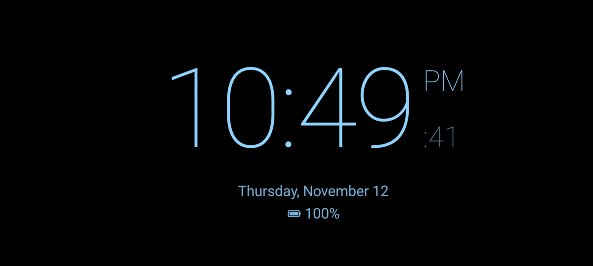

# Nocturna

[](https://github.com/adriandeleon/Nocturna/actions/workflows/ci.yml)
[](LICENSE)


A bedside clock for Android: a big, dimmable clock for the nightstand while your phone charges.



## Features

- **Clock**: digital (six font styles, 12/24 h, optional seconds) or analog, in a colour you pick.
- **Info line**: date, weather (Open-Meteo, no API key), battery and charging state, next alarm, now-playing radio station.
- **Notification icons**: icons of pending notifications under the clock (needs notification access).
- **Brightness**: follows the room's light sensor between a darkest and brightest level you set.
- **Night mode**: when the room goes dark the clock turns dim red. Without a light sensor it follows the time (22:00–07:00).
- **Burn-in protection**: the clock drifts slowly around the screen.
- **Day mode**: for a phone on a desk stand while you work. The clock sits beside this month's calendar and today's events from the calendars on the phone (needs calendar access; without it, the month alone). It never turns night red.
- **Alarms**: repeat days, labels, snooze, a gentle volume ramp, vibration, and a full-screen wake-up screen over the lock screen. An alarm can wake you with a radio station, and falls back to the alarm tone if the station doesn't play. A repeating alarm can skip its next ring.
- **Web radio**: any MP3/AAC/HLS stream, with a sleep timer that fades out (15/30/60/90 min).
- **Starts on its own**:
  - as the Android screen saver (Settings › Display › Screen saver › Nocturna, "while charging"), or
  - with **Open when charging**, which opens the clock when you plug in a locked phone. This needs the "Display over other apps" permission; without it the app shows a full-screen notification instead.

Tap the clock to show the controls (Day mode, Alarms, Radio, Sleep timer, Settings).

## Build

Requirements: JDK 17+ and the Android SDK (platform 37, build-tools) with `sdk.dir` set in `local.properties`.

```bash
./gradlew :app:assembleDebug
adb install -r app/build/outputs/apk/debug/app-debug.apk
```

The debug build installs as `com.adl.nocturna.debug`, so it can sit next to a release build.

## Layout

| Package | What's in it |
|---|---|
| `clock` | `ClockActivity`, the shared `ClockScreen`, clock faces, sensor/battery/alarm state |
| `day` | Day mode: the month calendar, today's events from the calendar provider |
| `dream` | `NocturnaDream`, the screen saver |
| `alarm` | Scheduling (`AlarmManager.setAlarmClock`), the ringing service, the wake-up screen, boot receiver |
| `radio` | Media3 `RadioService` and the `Radio` controller with the sleep timer |
| `weather` | Open-Meteo current conditions and city search |
| `notify` | Notification listener that mirrors notification icons |
| `charging` | Foreground service that opens the clock when the charger is connected |
| `settings` | Settings, alarms, stations and About screens |
| `data` | Settings and alarms, stored as JSON in SharedPreferences |

## License

MIT, see [LICENSE](LICENSE). Third-party components and the weather data's attribution are in [NOTICE](NOTICE);
what changed is in [CHANGELOG.md](CHANGELOG.md).
