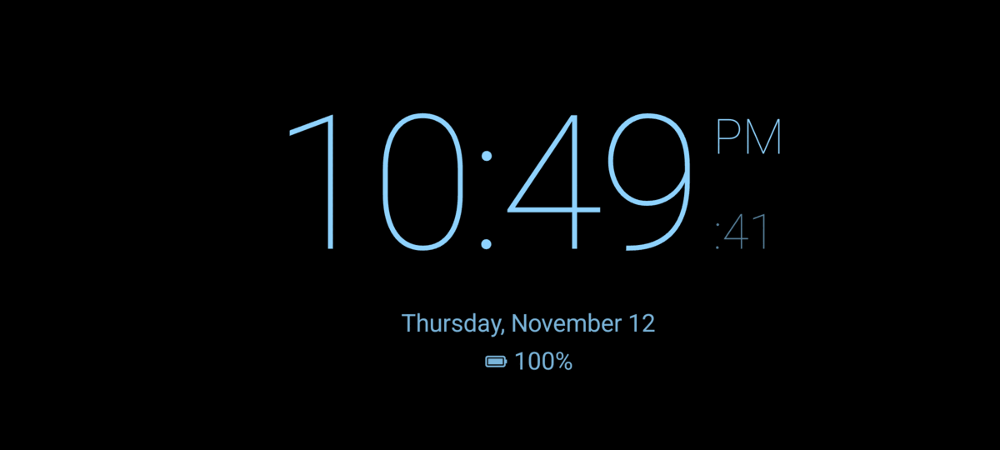
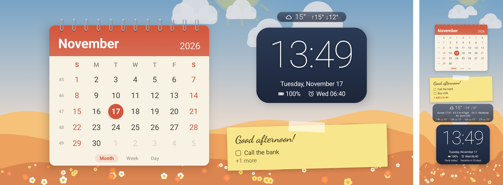

# Nocturna

[](https://github.com/adriandeleon/Nocturna/actions/workflows/ci.yml)
[](LICENSE)


A bedside clock for Android: a big, dimmable clock for the nightstand while your phone charges.



## Features

- **Clock**: digital (six font styles, 12/24 h, optional seconds) or analog, in a colour you pick.
- **Info line**: date, weather with today's high and low, or tomorrow's forecast in the evening (Open-Meteo, no API key), battery and charging state, next alarm, now-playing radio station.
- **Notification icons**: icons of pending notifications under the clock (needs notification access).
- **Brightness**: follows the room's light sensor between a darkest and brightest level you set.
- **Night mode**: when the room goes dark the clock turns dim red. Without a light sensor it follows the time (22:00–07:00).
- **Burn-in protection**: the clock drifts slowly around the screen.
- **Day mode**: a cheerful desk clock, calendar page and sticky note for a phone on a desk stand while you work. See [Day mode](#day-mode).
- **Alarms**: repeat days, labels, snooze, a gentle volume ramp, vibration, and a full-screen wake-up screen over the lock screen. An alarm can wake you with a radio station, and falls back to the alarm tone if the station doesn't play. A repeating alarm can skip its next ring.
- **Sunrise before alarms**: in the 10, 20 or 30 minutes before an alarm (not a snooze) the clock brightens to your brightest level and warms from night red through amber to a soft white.
- **Sleep sounds**: white, pink and brown noise, rain and surf, made on the phone so they play offline; they loop seamlessly and play from the Radio button like a station, sleep timer included.
- **Web radio**: any MP3/AAC/HLS stream, with a sleep timer that fades out (15/30/60/90 min).
- **Backup**: export settings, radio stations and alarms to one JSON file and import them on this or another phone (Settings › About › Backup). The Day mode photo isn't included. No storage permission: you pick the file.
- **Starts on its own**:
  - as the Android screen saver (Settings › Display › Screen saver › Nocturna, "while charging"), or
  - with **Open when charging**, which opens the clock when you plug in a locked phone. This needs the "Display over other apps" permission; without it the app shows a full-screen notification instead.

Tap the clock to show the controls (Day mode, Alarms, Radio, Sleep timer, Settings).

## Day mode



The bedside clock is for the night; Day mode is for the desk, when your phone sits on a charging stand while you work.

- **Desk clock**: the time, date, weather, battery and next alarm, in white on a navy panel that reads over any background.
- **Calendar page**: a spiral-bound page in the month's own colour, in one of three views. **Month** has today circled, weekends highlighted and a dot under each day that has events. **Week** shows this week a day per row, with each day's events. **Day** is a tear-off page: today's big date beside the whole day's schedule, finished events faded. Swipe the page left for more detail (month, week, day) and right to go back, or tap *Month · Week · Day* under it. Settings › Day mode › *Calendar view* picks the view it starts with. In the day view the sticky note steps aside, since the page already shows the whole day.
- **Sticky note**: a greeting for the time of day and the rest of today's events. The one happening now is marked *Now · until …*; finished ones drop off; if they don't all fit, the note says how many more there are.
- **Next-meeting countdown**: in the hour before a timed event, the note puts it at the top, counting down (*In 12 min · 10:00*, then *In 1 min*) until it turns into *Now · until …*. All-day events don't count down. Where the note isn't showing (the day view, or a phone held sideways with no room under the clock), *Standup in 12 min* hangs in a small tag under the desk clock instead. Tap either to open the event. Settings › Day mode › *Chime before meetings* adds one soft tone 1, 2 or 5 minutes before (Off by default): at the notification volume, never the alarm's, once per meeting, only while Day mode is showing, and not when the phone is on silent, vibrate or Do Not Disturb.
- **Background**: a sunny scene that changes every month, from snow in January to blossoms in April, sunflowers in August, autumn hills in October and fir trees in December. It follows the time of day: a peachy dawn in the morning, the month's bright sky at midday, golden light in the afternoon and a starry night with the moon after dark, blending slowly from one to the next. The clouds drift and the sun's rays turn slowly. To use a photo of your own instead, go to Settings › Day mode › *Background* and tap *Monthly pictures*. Nocturna keeps its own smaller copy, so it needs no storage permission and keeps working if you delete the original. *Use the monthly pictures* switches back.

**Tap to open your calendar**: tap a day on the page to open your calendar app on that date, tap an event on the sticky note to open the event, or tap anywhere else on the note to open today. If the phone is locked, it asks you to unlock first. Tapping anywhere else shows the clock's buttons, as usual; the screen saver is for looking only.

Side by side in landscape, stacked in portrait. Day mode never turns night red; brightness still follows the room light if *Adjust to room light* is on, but stops at 50%, so a screen that's lit all day wears more slowly. Change it in Settings › Day mode › *Screen care*.

**Burn-in protection**: Day mode stays on screen all day, so on OLED screens nothing in it stays put. With *Burn-in protection* on, the layout drifts around a tenth of the screen, the clock, the calendar page and the sticky note each drift on their own as well, and every other hour the clock and the page trade places (sides in landscape, top and bottom in portrait). The page's paper, the brightest thing on screen, dims by about a quarter over its first four hours up, too slowly to notice. The background keeps moving whatever the setting: the sun crosses the sky from dawn to dusk and the moon from dusk to dawn, the stars turn, the clouds float up and down as they pass, the hills scroll, swell and change shape, the flowers and trees sway in the breeze, wander about and grow and shrink a little, and are replanted every hour, and your own photo pans gently. The page and the note use warm tones a touch below white.

**Turning it on**: in Settings › Day mode, pick *Always*, or *On a schedule* with the hours and days you work, for example weekdays 09:00–18:00 (hours can run past midnight). On the clock, tap it, then *Day mode* or *Clock only*; with a schedule, that lasts until the schedule's next start or end. The screen saver follows the same setting.

**Today's events** (Settings › Day mode › *Today's events*): read from the calendars synced to the phone, such as Google Calendar. Hidden calendars and invitations you declined are left out. Nocturna asks for calendar access when you turn this on and only ever reads; without access you get the calendar page alone.

## Build

Requirements: JDK 17+ and the Android SDK (platform 37, build-tools) with `sdk.dir` set in `local.properties`.

```bash
./gradlew :app:assembleDebug
adb install -r app/build/outputs/apk/debug/app-debug.apk
```

The debug build installs as `com.adl.nocturna.debug`, so it can sit next to a release build.

The project has two Gradle modules: `app`, the Android app, and `shared`, a Kotlin Multiplatform module with
the code that doesn't depend on Android, ready for an iOS app later. Both use the packages below.

## Layout

| Package | What's in it |
|---|---|
| `clock` | `ClockScreen` and the clock faces (`shared`), which reach the phone through `ClockPlatform`; `ClockActivity`, `AndroidClockPlatform` and its sensor/battery/alarm state (`app`); the brightness curve and the sunrise before alarms |
| `day` | Day mode: the desk calendar page and sticky note and the monthly scenes (`shared`); the background photo and today's events from the calendar provider (`app`); the schedule |
| `dream` | `NocturnaDream`, the screen saver |
| `alarm` | Scheduling (`AlarmManager.setAlarmClock`), the ringing service, the wake-up screen, boot receiver |
| `radio` | Media3 `RadioService` and the `Radio` controller with the sleep timer |
| `sound` | The sleep sounds: seeded noise, rain and surf generators that loop seamlessly, and the WAV encoder (`shared`); their cached WAV files (`app`, in `radio`) |
| `weather` | Open-Meteo current conditions, forecast and city search; the phone's location (`app`) |
| `notify` | Notification listener that mirrors notification icons |
| `charging` | Foreground service that opens the clock when the charger is connected |
| `settings` | The Settings hub and its pages: clock face, info line, brightness, day mode, weather, starting, alarms, stations, About |
| `data` | Settings and alarms and their stores, kept as JSON in device-protected SharedPreferences on Android; the backup file format (`shared`) |
| `text`, `ui` | Dates and names in the phone's language, the theme and the icons (`shared`) |

## License

MIT, see [LICENSE](LICENSE). Third-party components and the weather data's attribution are in [NOTICE](NOTICE);
what changed is in [CHANGELOG.md](CHANGELOG.md).
