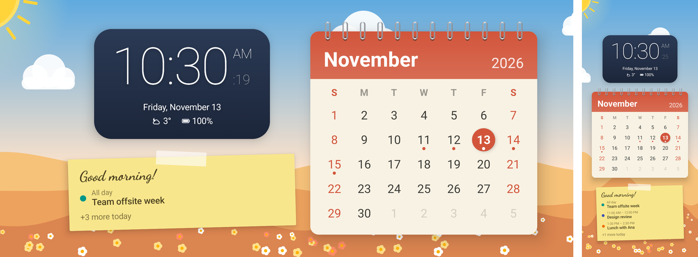

# Nocturna

[](https://github.com/adriandeleon/Nocturna/actions/workflows/ci.yml)
[](LICENSE)


A bedside clock for Android: a big, dimmable clock for the nightstand while your phone charges.


## Features

- **Clock**: digital (six font styles, 12/24 h, optional seconds) or analog, in a colour you pick.
- **Info line**: date, weather with today's high and low, or tomorrow's forecast in the evening (Open-Meteo, no API key), battery and charging state, next alarm, now-playing radio station.
- **Notification icons**: icons of pending notifications under the clock (needs notification access).
- **Brightness**: follows the room's light sensor between a darkest and brightest level you set.
- **Night mode**: when the room goes dark the clock turns dim red. Without a light sensor it follows the time (22:00–07:00).
- **Burn-in protection**: the clock drifts slowly around the screen.
- **Day mode**: a cheerful desk clock, calendar page and sticky note for a phone on a desk stand while you work. See [Day mode](#day-mode).
- **Alarms**: repeat days, labels, snooze, a gentle volume ramp, vibration, and a full-screen wake-up screen over the lock screen. An alarm can wake you with a radio station, and falls back to the alarm tone if the station doesn't play. A repeating alarm can skip its next ring.
- **Web radio**: any MP3/AAC/HLS stream, with a sleep timer that fades out (15/30/60/90 min).
- **Starts on its own**:
  - as the Android screen saver (Settings › Display › Screen saver › Nocturna, "while charging"), or
  - with **Open when charging**, which opens the clock when you plug in a locked phone. This needs the "Display over other apps" permission; without it the app shows a full-screen notification instead.

Tap the clock to show the controls (Day mode, Alarms, Radio, Sleep timer, Settings).

## Day mode



The bedside clock is for the night; Day mode is for the desk, when your phone sits on a charging stand while you work.

- **Desk clock**: the time, date, weather, battery and next alarm, in white on a navy panel that reads over any background.
- **Calendar page**: this month on a spiral-bound page in the month's own colour, with today circled, weekends highlighted and a dot under each day that has events.
- **Sticky note**: a greeting for the time of day and the rest of today's events. The one happening now is marked *Now · until …*; finished ones drop off; if they don't all fit, the note says how many more there are.
- **Background**: a sunny scene that changes every month, from snow in January to blossoms in April, sunflowers in August, autumn hills in October and fir trees in December. The clouds drift and the sun's rays turn slowly. To use a photo of your own instead, go to Settings › Day mode › *Background*. Nocturna keeps its own smaller copy, so it needs no storage permission and keeps working if you delete the original. *Use the monthly pictures* switches back.

Side by side in landscape, stacked in portrait. Day mode never turns night red; brightness still follows the room light if *Adjust to room light* is on.

**Burn-in protection**: Day mode stays on screen all day, so on OLED screens nothing in it stays put. With *Burn-in protection* on, the layout drifts around a tenth of the screen, and in landscape the clock and the calendar page swap sides every hour. The background keeps moving whatever the setting: the hills scroll slowly, the sun circles its corner and your own photo pans gently. The page and the note use warm tones a touch below white.

**Turning it on**: in Settings › Day mode, pick *On*, or *On a schedule* with the hours and days you work, for example weekdays 09:00–18:00 (hours can run past midnight). On the clock, tap it, then *Day mode* or *Clock only*; with a schedule, that lasts until the schedule's next start or end. The screen saver follows the same setting.

**Today's events** (Settings › Day mode › *Today's events*): read from the calendars synced to the phone, such as Google Calendar. Hidden calendars and invitations you declined are left out. Nocturna asks for calendar access when you turn this on and only ever reads; without access you get the calendar page alone.

## Build

Requirements: JDK 17+ and the Android SDK (platform 37, build-tools) with `sdk.dir` set in `local.properties`.

```bash
./gradlew :app:assembleDebug
adb install -r app/build/outputs/apk/debug/app-debug.apk
```

The debug build installs as `com.adl.nocturna.debug`, so it can sit next to a release build.

## Layout

| Package | What's in it |
|---|---|
| `clock` | `ClockActivity`, the shared `ClockScreen`, clock faces, sensor/battery/alarm state |
| `day` | Day mode: the desk calendar page and sticky note, the monthly scenes, the background photo, today's events from the calendar provider, the schedule |
| `dream` | `NocturnaDream`, the screen saver |
| `alarm` | Scheduling (`AlarmManager.setAlarmClock`), the ringing service, the wake-up screen, boot receiver |
| `radio` | Media3 `RadioService` and the `Radio` controller with the sleep timer |
| `weather` | Open-Meteo current conditions and city search |
| `notify` | Notification listener that mirrors notification icons |
| `charging` | Foreground service that opens the clock when the charger is connected |
| `settings` | Settings, alarms, stations and About screens |
| `data` | Settings and alarms, stored as JSON in SharedPreferences |

## License

MIT, see [LICENSE](LICENSE). Third-party components and the weather data's attribution are in [NOTICE](NOTICE);
what changed is in [CHANGELOG.md](CHANGELOG.md).
